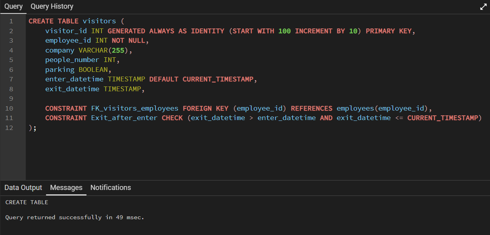
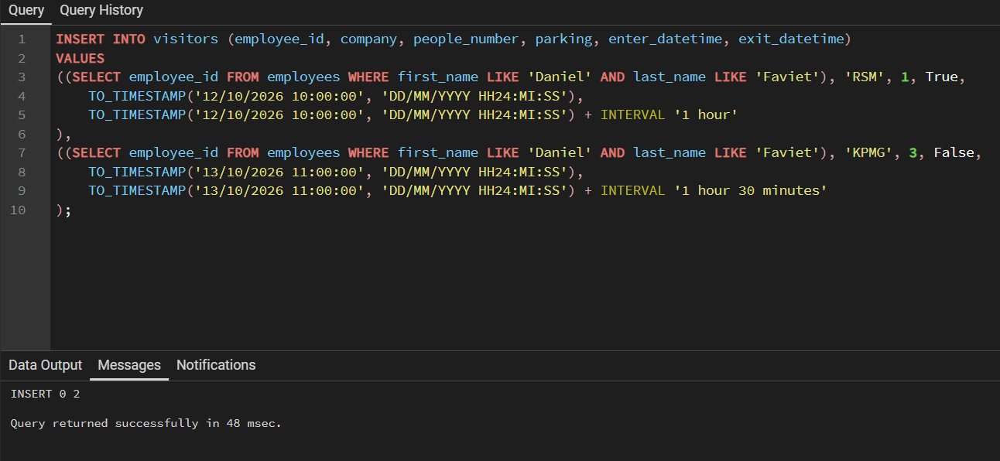
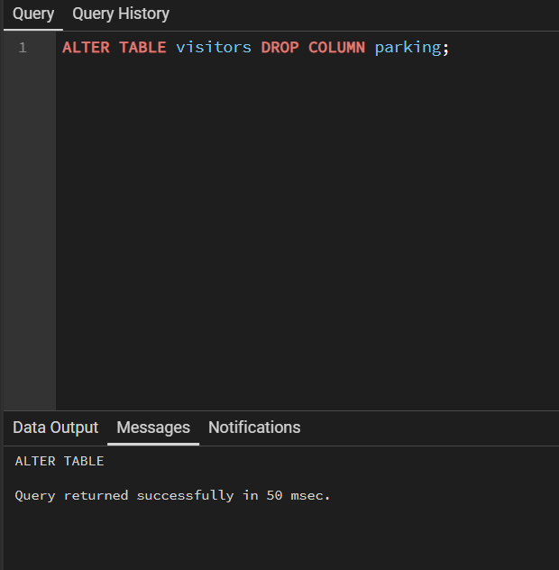
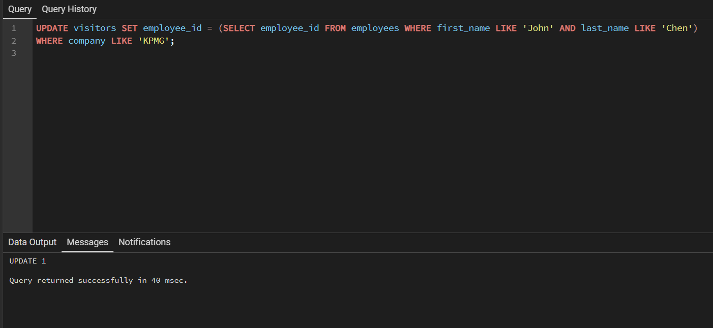
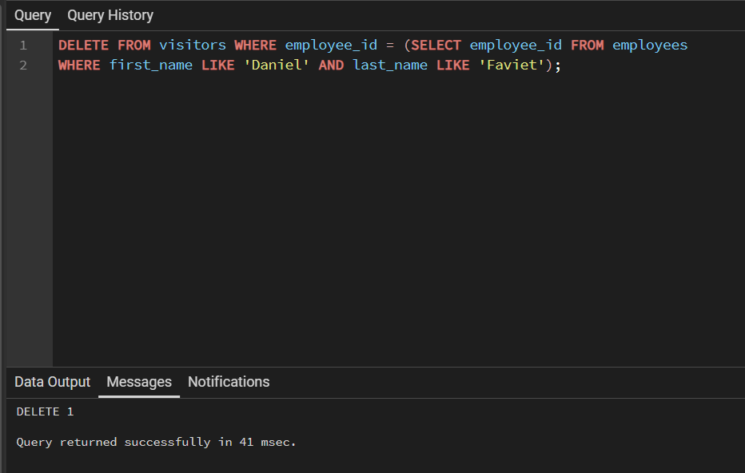

1. Utwórz nową tabelę dotyczącą odwiedzających firmę o nazwie visitors, która będzie zawierać wymienione pola:
– visitor_id – klucz główny automatycznie numerowany od 100 co 10,
– employee_id – klucz obcy do tabeli pracowników odwołujący się do danych pracownika odpowiedzialnego za odwiedzających,
– company – nazwa firmy, którą reprezentują odwiedzający,
– people_number – liczba osób odwiedzających,
– parking – informacja o tym, czy odwiedzający korzystali z firmowego parkingu,
– enter_datetime – data i godzina rozpoczęcia wizyty,
– exit_datetime – data i godzina zakończenia wizyty.
Dodatkowo zadbaj o:
– konieczność podania wartości w polu employee_id,
– ustawienie domyślnej wartości aktualnej daty i czasu w polu enter_datetime,
– wprowadzenie takiego ograniczenia wartości w polu exit_datetime, że musi być ona późniejsza niż wartość w polu enter_datetime oraz wcześniejsza albo równa aktualnej dacie i godzinie.

Wersja SQL Server:
```sql
CREATE TABLE visitors (
    visitor_id INT IDENTITY(100, 10) PRIMARY KEY,
    employee_id INT NOT NULL,
    company VARCHAR(255),
    people_number INT,
    parking BIT,
    enter_datetime DATETIME DEFAULT CURRENT_TIMESTAMP,
    exit_datetime DATETIME,
    
    CONSTRAINT FK_visitors_employees FOREIGN KEY (employee_id) REFERENCES employees(employee_id),
    CONSTRAINT Exit_after_enter CHECK (exit_datetime > enter_datetime AND exit_datetime <= GETDATE())
);
```

Wersja PostgreSQL:
```sql
CREATE TABLE visitors (
    visitor_id INT GENERATED ALWAYS AS IDENTITY (START WITH 100 INCREMENT BY 10) PRIMARY KEY,
    employee_id INT NOT NULL,
    company VARCHAR(255),
    people_number INT,
    parking BOOLEAN,
    enter_datetime TIMESTAMP DEFAULT CURRENT_TIMESTAMP,
    exit_datetime TIMESTAMP,
    
    CONSTRAINT FK_visitors_employees FOREIGN KEY (employee_id) REFERENCES employees(employee_id),
    CONSTRAINT Exit_after_enter CHECK (exit_datetime > enter_datetime AND exit_datetime <= CURRENT_TIMESTAMP)
);
```



2. Dodaj dane o odwiedzających pracownika Daniela Favieta:
– 1 pracownik firmy RSM przyszedł na trwające 1h spotkanie w dniu 12/10/2026 o godzinie 10:00 i skorzystał on z firmowego parkingu,
– 3 pracowników firmy KPMG przyszło na trwające 1,5h spotkanie w dniu 13/10/2026 o godzinie 11:00.

Wersja SQL Server:
```sql
INSERT INTO visitors (employee_id, company, people_number, parking, enter_datetime, exit_datetime) 
VALUES ((SELECT employee_id FROM employees WHERE first_name LIKE 'Daniel' AND last_name LIKE 'Faviet'), 'RSM', 1, 1, 
    CONVERT(DATETIME, '12/10/2026 10:00:00', 103), DATEADD(hour, 1, CONVERT(DATETIME, '12/10/2026 10:00:00', 103))
),
((SELECT employee_id FROM employees WHERE first_name LIKE 'Daniel' AND last_name LIKE 'Faviet'), 'KPMG', 3, 0, 
    CONVERT(DATETIME, '13/10/2026 11:00:00', 103), DATEADD(minute, 90, CONVERT(DATETIME, '13/10/2026 11:00:00', 103))
);
```

Wersja PostgreSQL:
```sql
INSERT INTO visitors (employee_id, company, people_number, parking, enter_datetime, exit_datetime) 
VALUES 
((SELECT employee_id FROM employees WHERE first_name LIKE 'Daniel' AND last_name LIKE 'Faviet'), 'RSM', 1, True, 
    TO_TIMESTAMP('12/10/2026 10:00:00', 'DD/MM/YYYY HH24:MI:SS'), 
    TO_TIMESTAMP('12/10/2026 10:00:00', 'DD/MM/YYYY HH24:MI:SS') + INTERVAL '1 hour'
),
((SELECT employee_id FROM employees WHERE first_name LIKE 'Daniel' AND last_name LIKE 'Faviet'), 'KPMG', 3, False, 
    TO_TIMESTAMP('13/10/2026 11:00:00', 'DD/MM/YYYY HH24:MI:SS'), 
    TO_TIMESTAMP('13/10/2026 11:00:00', 'DD/MM/YYYY HH24:MI:SS') + INTERVAL '1 hour 30 minutes'
);
```


3. Usuń pole parking z tabeli odwiedzających.

```sql
ALTER TABLE visitors DROP COLUMN parking;
```


4. Przypisz odwiedzających z firmy KPMG do pracownika Johna Chena, który rzeczywiście uczestniczył w tym spotkaniu.

```sql
UPDATE visitors SET employee_id = (SELECT employee_id FROM employees WHERE first_name LIKE 'John' AND last_name LIKE 'Chen')
WHERE company LIKE 'KPMG';
```



5. Usuń wszystkie informacje o odwiedzających pracownika Daniela Favieta.

```sql
DELETE FROM visitors WHERE employee_id = (SELECT employee_id FROM employees 
WHERE first_name LIKE 'Daniel' AND last_name LIKE 'Faviet');
```



6. Usuń tabelę odwiedzających.

```sql
DROP TABLE visitors;
```

