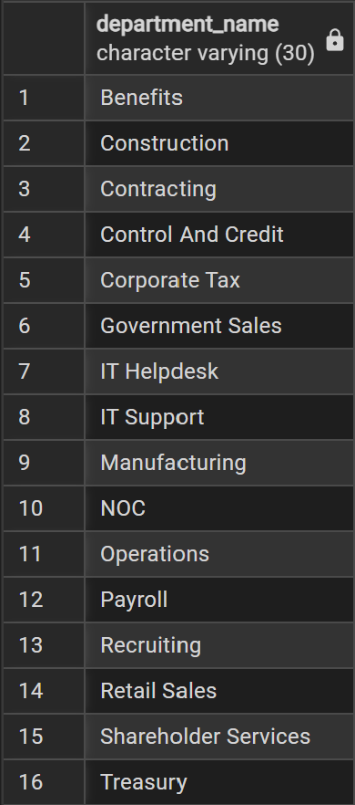
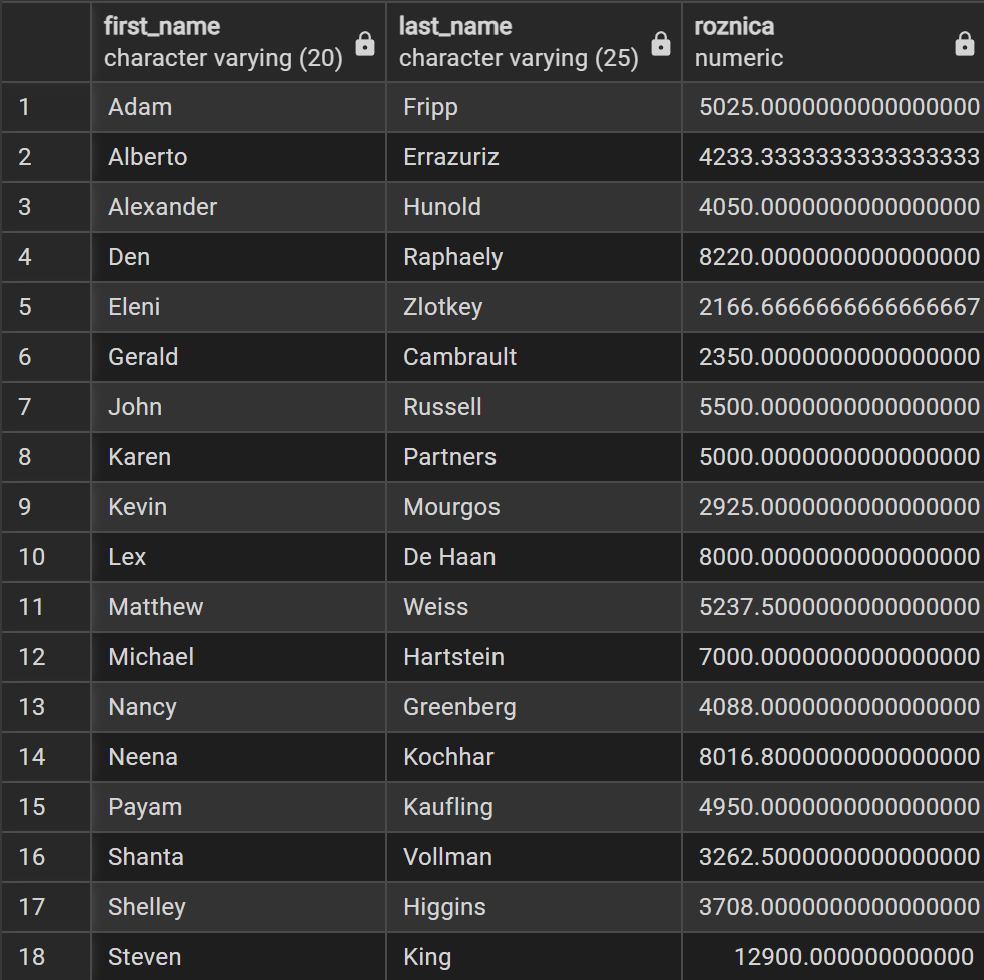
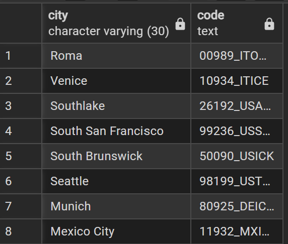
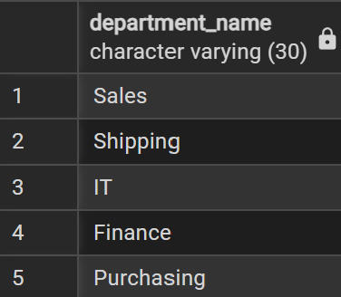
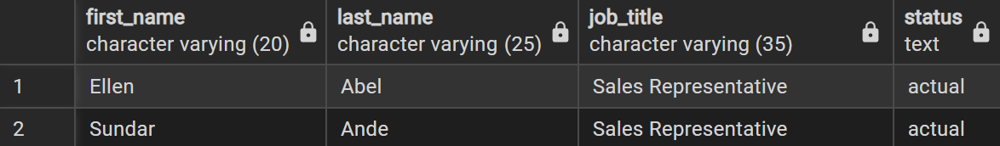
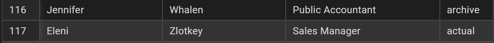

# Zadanie 2

Patryk Nagórka 254825

### 1. Wyświetl nazwy departamentów, w których nie jest zatrudniony żaden pracownik.

**PostgreSQL / SQL Server**

```sql
SELECT d.department_name FROM departments d
LEFT JOIN employees e ON d.department_id = e.department_id
WHERE e.department_id IS NULL
ORDER BY d.department_name;
```



### 2. Dla każdego menedżera wyświetl jego imię i nazwisko oraz różnicę pomiędzy jego wynagrodzeniem a średnim wynagrodzeniem pracowników bezpośrednio mu podlegających.

**PostgreSQL / SQL Server**

```sql
SELECT DISTINCT e.first_name, e.last_name, (e.salary - AVG(em.salary)) AS roznica FROM employees e 
JOIN employees em ON e.employee_id = em.manager_id
GROUP BY  e.employee_id, e.first_name, e.last_name, e.salary
ORDER BY  e.first_name;
```



### 3. Wyświetl nazwy miast oraz ich kody lokalizacji (nazwij tę kolumnę code) w postaci 00000_KKMMM, gdzie:

- 00000 – pięciocyfrowy kod pocztowy,
- KK – kod kraju,
- MMM – 3 ostatnie litery nazwy miasta zapisane za pomocą wielkich liter.

Wynik ogranicz do miast, których kod pocztowy składa się z dokładnie 5 cyfr.  

**PostgreSQL**

```sql
SELECT l.city, LEFT(l.postal_code, 5) || '_' || l.country_id || UPPER(RIGHT(l.city, 3)) AS code
FROM locations AS l
WHERE LENGTH(l.postal_code) = 5 AND l.postal_code NOT LIKE '%[A-Z]%';
```

**SQL Server**

```sql
SELECT l.city, LEFT(l.postal_code, 5) + '_' + l.country_id + UPPER(RIGHT(l.city, 3)) AS code
FROM locations AS l
WHERE LEN(l.postal_code) = 5 AND l.postal_code NOT LIKE '%[A-Z]%';
```



### 4. Wyświetl nazwy departamentów, w których zatrudnionych jest więcej pracowników niż wynosi średnia liczba pracowników we wszystkich departamentach.

**PostgreSQL / SQL Server**

```sql
WITH employees_department AS (
SELECT d.department_name, COUNT(e.employee_id) AS e_count 
FROM departments d
LEFT JOIN employees e ON d.department_id = e.department_id
GROUP BY d.department_id, d.department_name
)
SELECT department_name 
FROM employees_department 
WHERE e_count > 
(SELECT AVG(e_count) FROM employees_department)
```



### 5. Dla każdego pracownika wyświetl jego imię i nazwisko, nazwy jego stanowisk oraz informację o tym, które z nich jest aktualne:

- "actual" w przypadku, gdy dane stanowisko jest aktualnym stanowiskiem pracownika,
- "archive" w przypadku, gdy dane stanowisko jest poprzednim stanowiskiem pracownika.

Wyniki posortuj alfabetycznie według nazwiska, imienia oraz nazwy stanowiska.  

**PostgreSQL / SQL Server**

```sql
SELECT e.first_name, e.last_name, j.job_title, 'archive' AS status FROM employees e
JOIN job_history jh ON e.employee_id = jh.employee_id
JOIN jobs j ON jh.job_id = j.job_id

UNION ALL

SELECT e.first_name, e.last_name, j.job_title, 'actual' AS status FROM employees e
JOIN jobs j ON e.job_id = j.job_id
ORDER BY last_name, first_name, job_title
```




