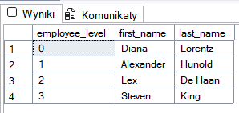
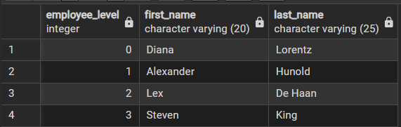

Krzysztof Kata 254776

1. Wyświetl imiona i nazwiska menedżerów Diany Lorentz zgodnie z hierarchią w firmie. Do każdego takiego pracownika dopisz jego poziom. Listę pracowników rozpocznij od Diany Lorentz. W rozwiązaniu wykorzystaj rekurencję, klauzulę with oraz operator sumy zbiorów.

Oczekiwany wynik:
employee_level   first_name       last_name
0                Diana            Lorentz
1                Alexander        Hunold
2                Lex              De Haan
3                Steven           King

Interpretacja:
Diana Lorentz jest pracownikiem na poziomie 0. Alexander Hunold jest menedżerem Diany Lorentz, zatem jest na poziomie 1. Lex De Haan jest menedżerem Alexandra Hunolda, zatem jest na poziomie 2. Steven King jest menedżerem Lexa De Haana, zatem jest na poziomie 3.

Wersja SQL Server:
```sql
WITH chierarchia AS (
SELECT 0 AS employee_level, e.employee_id, e.first_name, e.last_name, e.manager_id
FROM employees AS e
WHERE e.first_name LIKE 'Diana' AND e.last_name LIKE 'Lorentz'

UNION ALL

SELECT p.employee_level + 1, en.employee_id, en.first_name, en.last_name, en.manager_id
FROM chierarchia AS p
JOIN employees as en ON en.employee_id = p.manager_id
)


SELECT employee_level, first_name, last_name
FROM chierarchia
ORDER BY employee_level

```


Wersja PostgreSQL:
```sql
WITH RECURSIVE chierarchia AS (
SELECT 0 AS employee_level, e.employee_id, e.first_name, e.last_name, e.manager_id
FROM employees AS e
WHERE e.first_name LIKE 'Diana' AND e.last_name LIKE 'Lorentz'

UNION

SELECT p.employee_level + 1, en.employee_id, en.first_name, en.last_name, en.manager_id
FROM chierarchia AS p
JOIN employees as en ON en.employee_id = p.manager_id
)


SELECT employee_level, first_name, last_name
FROM chierarchia
ORDER BY employee_level

```
