# Zadanie domowe 2

Sprawozdanie z APDB

**Autorzy**

- Krzysztof Kata, 254776
- Patryk Nagórka, 254825
- Jakub Żmijowski, 254919

---

## Zadanie 1

Utwórz funkcję, która zwraca liczbę pracowników zatrudnionych na wskazanym stanowisku, w podanym dziale i kraju. Przekaż nazwę stanowiska, działu i kraju jako parametry. Wywołaj funkcję z argumentami Sales Manager, Sales i United Kingdom.

[Zadanie 1](Zad1/Zadanie_1.sql)

### SQL Server

```sql
CREATE OR ALTER FUNCTION dbo.l_pracownikow
(
    @stanowisko VARCHAR(255),
    @dzial VARCHAR(255),
    @kraj VARCHAR(255)
)
RETURNS INT
AS
BEGIN
    DECLARE @liczba_pracownikow INT;

    SELECT @liczba_pracownikow = COUNT(e.employee_id)
    FROM employees e
    JOIN departments d ON e.department_id = d.department_id
    JOIN locations l ON d.location_id = l.location_id
    JOIN countries c ON l.country_id = c.country_id
    JOIN jobs j ON e.job_id = j.job_id
    WHERE j.job_title = @stanowisko
      AND d.department_name = @dzial
      AND c.country_name = @kraj;

    RETURN @liczba_pracownikow;
END;
GO

SELECT dbo.l_pracownikow ('Sales Manager', 'Sales', 'United Kingdom') AS liczba_pracownikow;
```

### PostgreSQL

```sql
CREATE OR REPLACE FUNCTION l_pracownikow( stanowisko VARCHAR, dzial VARCHAR, kraj VARCHAR)
RETURNS INT
LANGUAGE sql
AS $$
    SELECT COUNT(e.employee_id)
    FROM employees e
    JOIN departments d ON e.department_id = d.department_id
    JOIN locations l ON d.location_id = l.location_id
    JOIN countries c ON l.country_id = c.country_id
    JOIN jobs j ON e.job_id = j.job_id
    WHERE j.job_title = stanowisko
      AND d.department_name = dzial
      AND c.country_name = kraj;
$$;

SELECT l_pracownikow('Sales Manager', 'Sales', 'United Kingdom') AS liczba_pracownikow;
```

## Zadanie 2

### Polecenie

Utwórz wyzwalacz, który przy zmianie stanowiska danego pracownika:
- zaktualizuje datę jego zatrudnienia w tabeli employees na jutrzejszą,
- zarchiwizuje dane o jego poprzednim stanowisku, tzn. doda odpowiednie informacje do tabeli job_history i ustawi datę zakończenia na dzisiejszą,
- sprawdzi, czy jego aktualne wynagrodzenie należy do zdefiniowanego przedziału wartości wynagrodzeń dla jego nowego stanowiska. Jeżeli jego aktualne wynagrodzenie jest niższe niż minimalna wartość przedziału, to zaktualizuje je do tej wartości oraz wypisze informację o imieniu i nazwisku pracownika i kwocie uzyskanej przez niego podwyżki. Jeżeli jego aktualne wynagrodzenie jest wyższe niż maksymalna wartość przedziału, to zaktualizuje maksymalne wynagrodzenie dla jego nowego stanowiska do wartości jego aktualnego wynagrodzenia.

Potwierdź działanie poprzez zmianę stanowiska Stevena Kinga na Shipping Clerk i zmianę stanowiska Douglasa Granta na President.

Uwaga! Wyzwalacz powinien działać także przy zmianie stanowiska wielu pracowników jednocześnie.

### SQL Server

```sql
CREATE TRIGGER after_update_employee_job
ON employees
FOR UPDATE
AS
BEGIN
    DECLARE
        @emp_id NUMERIC(6),
        @first_name VARCHAR(20),
        @last_name VARCHAR(25),
        @old_hire_date DATE,
        @old_job_id VARCHAR(10),
        @old_dept_id NUMERIC(4),
        @new_job_id VARCHAR(10),
        @new_salary NUMERIC(8,2),
        @min_salary NUMERIC(6),
        @max_salary NUMERIC(6),
        @dzis DATE = CAST(GETDATE() AS DATE),
        @jutro DATE = DATEADD(day, 1, CAST(GETDATE() AS DATE));

    DECLARE cur_zmiany CURSOR FOR
        SELECT
            d.employee_id,
            i.first_name,
            i.last_name,
            d.hire_date,
            d.job_id,
            d.department_id,
            i.job_id,
            i.salary
        FROM deleted d
        JOIN inserted i ON d.employee_id = i.employee_id
        WHERE d.job_id <> i.job_id;

    OPEN cur_zmiany;
    FETCH NEXT FROM cur_zmiany INTO
        @emp_id, @first_name, @last_name, @old_hire_date,
        @old_job_id, @old_dept_id, @new_job_id, @new_salary;

    WHILE @@FETCH_STATUS = 0
    BEGIN
        INSERT INTO job_history (employee_id, start_date, end_date, job_id, department_id)
        VALUES (@emp_id, @old_hire_date, @dzis, @old_job_id, @old_dept_id);

        UPDATE employees
        SET hire_date = @jutro
        WHERE employee_id = @emp_id;

        SELECT @min_salary = min_salary, @max_salary = max_salary
        FROM jobs
        WHERE job_id = @new_job_id;

        IF @new_salary < @min_salary
        BEGIN
            UPDATE employees
            SET salary = @min_salary
            WHERE employee_id = @emp_id;

            PRINT CONCAT(@first_name, ' ', @last_name, ' – kwota podwyżki: ', @min_salary - @new_salary);
        END
        ELSE IF @new_salary > @max_salary
        BEGIN
            UPDATE jobs
            SET max_salary = @new_salary
            WHERE job_id = @new_job_id;
        END;

        FETCH NEXT FROM cur_zmiany INTO
            @emp_id, @first_name, @last_name, @old_hire_date,
            @old_job_id, @old_dept_id, @new_job_id, @new_salary;
    END;

    CLOSE cur_zmiany;
    DEALLOCATE cur_zmiany;
END;
```

### PostgreSQL

```sql
CREATE FUNCTION updated_employee_job()
RETURNS TRIGGER AS
$$
DECLARE
	v_min_salary jobs.min_salary%TYPE;
	v_max_salary jobs.max_salary%TYPE;
BEGIN
	INSERT INTO job_history (employee_id, start_date, end_date, job_id, department_id)
	VALUES (OLD.employee_id, OLD.hire_date, CURRENT_DATE, OLD.job_id, OLD.department_id);

	UPDATE employees
	SET hire_date = DATE(CURRENT_DATE + 1)
	WHERE employee_id = OLD.employee_id;

		SELECT min_salary, max_salary
		INTO v_min_salary, v_max_salary
		FROM jobs
		WHERE job_id = NEW.job_id;

		IF NEW.salary < v_min_salary THEN
	        UPDATE employees
	        SET salary = v_min_salary
	        WHERE employee_id = NEW.employee_id;

	        RAISE NOTICE '% % – kwota podwyżki: %',
	            NEW.first_name, NEW.last_name, v_min_salary - NEW.salary;

	    ELSIF NEW.salary > v_max_salary THEN
	        UPDATE jobs
	        SET max_salary = NEW.salary
	        WHERE job_id = NEW.job_id;
	    END IF;

	RETURN NEW;
END;
$$
LANGUAGE
plpgsql;

CREATE TRIGGER after_update_employee_job
AFTER UPDATE OF job_id ON employees
FOR EACH ROW
EXECUTE FUNCTION updated_employee_job();
```

### Sprawdzenie działania

```sql
UPDATE employees
SET job_id = 'SH_CLERK'
WHERE first_name LIKE 'Steven' AND last_name LIKE 'King';

UPDATE employees
SET job_id = 'AD_PRES'
WHERE first_name LIKE 'Douglas' AND last_name LIKE 'Grant';
```

#### Wyniki w SQL Server

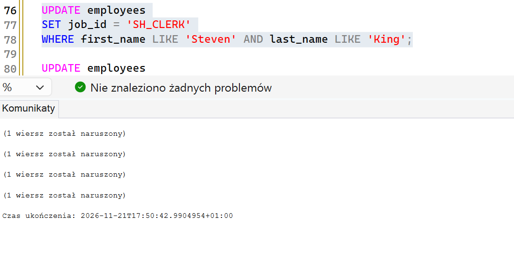

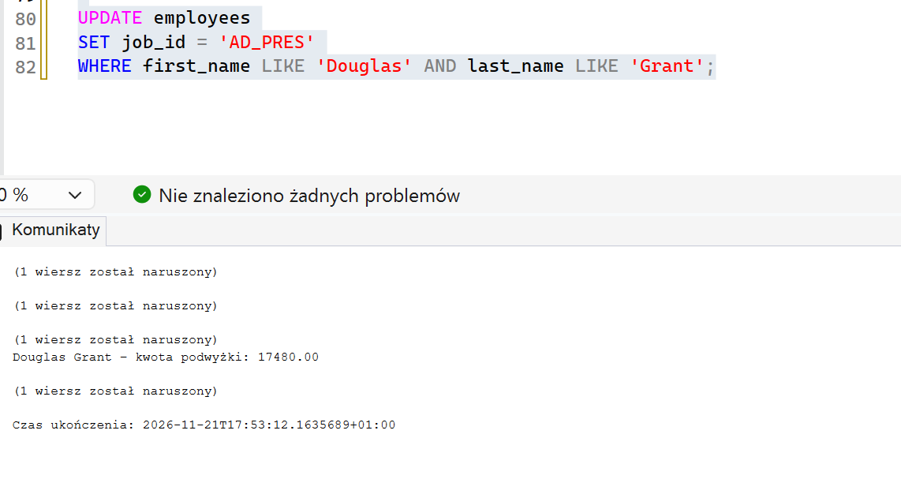

#### Wyniki w PostgreSQL

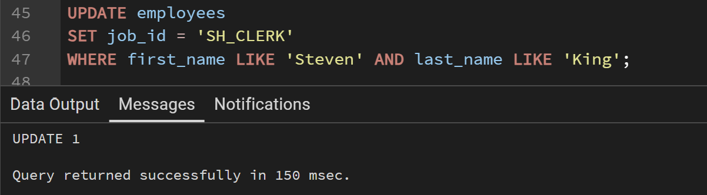

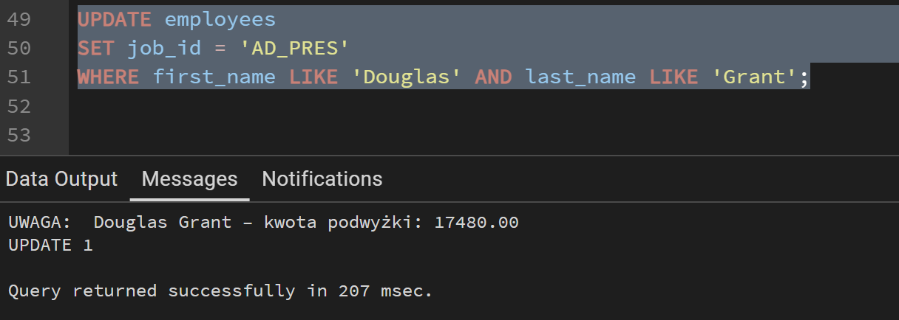

## Zadanie 3

### Polecenie

Utwórz procedurę, która zmieni stanowisko na wskazane u pracowników zatrudnionych na określonym stanowisku w określonym kraju i poprzez parametr wyjściowy zwróci liczbę zmodyfikowanych rekordów oraz – o ile to możliwe – wyświetli w tabeli emaile pracowników, których stanowisko zostało zmienione.
Dodatkowo wypisze nazwy wszystkich departamentów z danego kraju razem z listą imion i nazwisk zatrudnionych tam pracowników, których stanowisko zostało zmienione. Jeżeli w jakimś departamencie w danym kraju nie pracuje żaden pracownik na danym stanowisku, wywoła jak najwyższy priorytetowo komunikat, który nie przerwie wykonywania kodu i wypisze: "Brak pracowników na stanowisku X w departamencie Y w kraju Z!", gdzie X jest nazwą poprzedniego stanowiska, Y jest nazwą aktualnie sprawdzanego departamentu, Z jest nazwą wskazanego kraju.
Procedura powinna weryfikować wprowadzone dane. Jeżeli podany kraj nie istnieje, wywoła wyjątek, który przerwie wykonywanie kodu i wypisze: "Brak kraju X w bazie danych!", gdzie X to nazwa wskazanego kraju. Jeżeli w podanym kraju nie ma żadnego departamentu, wywoła wyjątek, który przerwie wykonywanie kodu i wypisze: "Brak departamentów w kraju X!", gdzie X to nazwa wskazanego kraju.
Wywołaj procedurę z parametrami Sales Manager, Sales Representative i United Kingdom (w obu konfiguracjach). Przetestuj też oba komunikaty błędów.
Uwaga! Twoje rozwiązanie powinno wykorzystywać funkcję z zadania 1 i wyzwalacz z zadania 2.
Uwaga! Na czas wykonywania zadania usuń klucz główny w tabeli job_history. Pozwoli to uniknąć błędu wynikającego z braku spójności danych.

### SQL Server

```sql
CREATE OR ALTER PROCEDURE dbo.Zmiana_stanowisk
    @stare_stanowisko VARCHAR(35),
    @nowe_stanowisko VARCHAR(35),
    @kraj VARCHAR(40),
    @liczba_zmienionych INT OUTPUT
AS
BEGIN

    DECLARE
        @country_id CHAR(2),
        @komunikat NVARCHAR(255),
        @stare_job_id VARCHAR(10),
        @nowe_job_id VARCHAR(10),
        @departament_id NUMERIC(4),
        @departament_name VARCHAR(30),
        @liczba_w_dziale INT;
        

    SET @liczba_zmienionych = 0;

    SELECT @country_id = country_id FROM countries
    WHERE country_name = @kraj;

    IF @country_id IS NULL
    BEGIN
        SET @komunikat = 'Brak kraju ' + @kraj + ' w bazie danych!';
        THROW 50001, @komunikat, 1;
    END;

    IF NOT EXISTS (
        SELECT 1 FROM departments d
        JOIN locations l ON l.location_id = d.location_id
        WHERE l.country_id = @country_id
    )
    BEGIN
        SET @komunikat = 'Brak departamentów w kraju ' + @kraj + '!';
        THROW 50002, @komunikat, 1;
    END;

    SELECT @stare_job_id = job_id FROM jobs
    WHERE job_title = @stare_stanowisko;

    SELECT @nowe_job_id = job_id FROM jobs
    WHERE job_title = @nowe_stanowisko;

    IF @stare_job_id IS NULL OR @nowe_job_id IS NULL
    BEGIN
        THROW 50003, 'Nie ma takiego stanowiska!', 1;
    END;

    CREATE TABLE #zmienieni (
        employee_id NUMERIC(6),
        first_name VARCHAR(20),
        last_name VARCHAR(25),
        email VARCHAR(25),
        department_id NUMERIC(4),
        department_name VARCHAR(30)
    );

    DECLARE department_cursor CURSOR LOCAL FAST_FORWARD FOR
        SELECT d.department_id, d.department_name FROM departments d
        JOIN locations l ON l.location_id = d.location_id
        WHERE l.country_id = @country_id
        ORDER BY d.department_id;

    OPEN department_cursor;

    FETCH NEXT FROM department_cursor
    INTO @departament_id, @departament_name;

    WHILE @@FETCH_STATUS = 0
    BEGIN
        SET @liczba_w_dziale = dbo.l_pracownikow(@stare_stanowisko, @departament_name, @kraj);

        IF @liczba_w_dziale = 0
        BEGIN
            RAISERROR(N'Brak pracowników na stanowisku %s w departamencie %s w kraju %s!', 10, 1, @stare_stanowisko, @departament_name, @kraj) 
            WITH NOWAIT;
        END
        ELSE
        BEGIN
            UPDATE e SET e.job_id = @nowe_job_id
            OUTPUT inserted.employee_id, inserted.first_name, inserted.last_name, inserted.email, inserted.department_id, @departament_name
            INTO #zmienieni(employee_id, first_name, last_name, email, department_id, department_name)
            FROM employees e
            WHERE e.department_id = @departament_id AND e.job_id = @stare_job_id;

            SET @liczba_zmienionych = @liczba_zmienionych + @liczba_w_dziale;
        END;

        FETCH NEXT FROM department_cursor
        INTO @departament_id, @departament_name;
    END;

    CLOSE department_cursor;
    DEALLOCATE department_cursor;

    IF EXISTS (SELECT 1 FROM #zmienieni)
    BEGIN
        SELECT email FROM #zmienieni
        ORDER BY email;
    END;

    SELECT d.department_name, z.first_name, z.last_name FROM departments d
    JOIN locations l ON l.location_id = d.location_id
    LEFT JOIN #zmienieni z ON z.department_id = d.department_id
    WHERE l.country_id = @country_id
    ORDER BY d.department_name, z.last_name, z.first_name;

    DROP TABLE #zmienieni;
END;
```

### PostgreSQL

```sql
CREATE OR REPLACE PROCEDURE zmiana_stanowisk(
    IN stare_stanowisko VARCHAR,
    IN nowe_stanowisko VARCHAR,
    IN kraj VARCHAR,
    OUT liczba_zmienionych INT,
    OUT emaile REFCURSOR,
    OUT departamenty REFCURSOR
)
LANGUAGE plpgsql
AS $$
DECLARE
    v_country_id CHAR(2);
    stare_job_id VARCHAR(10);
    nowe_job_id VARCHAR(10);
    departament_id NUMERIC(4);
    departament_name VARCHAR(30);
    liczba_w_dziale INT;

    departament_cursor CURSOR FOR
        SELECT d.department_id, d.department_name FROM departments d
        JOIN locations l ON l.location_id = d.location_id
        WHERE l.country_id = v_country_id
        ORDER BY d.department_id;

BEGIN
    liczba_zmienionych := 0;
	emaile := 'wynik_emaile';
	departamenty := 'wynik_departamenty';

    SELECT c.country_id INTO v_country_id FROM countries c
    WHERE c.country_name = kraj;

    IF v_country_id IS NULL THEN
        RAISE EXCEPTION 'Brak kraju % w bazie danych!', kraj;
    END IF;

    IF NOT EXISTS (
		SELECT 1 FROM departments d
        JOIN locations l ON l.location_id = d.location_id
        WHERE l.country_id = v_country_id
    ) THEN 
		RAISE EXCEPTION 'Brak departamentów w kraju %!', kraj;
    END IF;

    SELECT j.job_id INTO stare_job_id FROM jobs j
    WHERE j.job_title = stare_stanowisko;

    SELECT j.job_id INTO nowe_job_id FROM jobs j
    WHERE j.job_title = nowe_stanowisko;

    IF stare_job_id IS NULL OR nowe_job_id IS NULL THEN
        RAISE EXCEPTION 'Nie ma takiego stanowiska!';
    END IF;

    CREATE TEMP TABLE zmienieni (
        employee_id NUMERIC(6),
        first_name VARCHAR(20),
        last_name VARCHAR(25),
        email VARCHAR(25),
        department_id NUMERIC(4),
        department_name VARCHAR(30)
    ) ON COMMIT DROP;

    OPEN departament_cursor;

    LOOP
        FETCH NEXT FROM departament_cursor
        INTO departament_id, departament_name;

        EXIT WHEN NOT FOUND;

        liczba_w_dziale := l_pracownikow(stare_stanowisko, departament_name, kraj);

        IF liczba_w_dziale = 0 THEN
            RAISE WARNING 'Brak pracowników na stanowisku % w departamencie % w kraju %!',
                stare_stanowisko, departament_name, kraj;
        ELSE
            WITH zaktualizowani AS (
				UPDATE employees e SET job_id = nowe_job_id
                WHERE e.department_id = departament_id AND e.job_id = stare_job_id
                RETURNING e.employee_id, e.first_name, e.last_name, e.email, e.department_id
            )
            INSERT INTO pg_temp.zmienieni (employee_id, first_name, last_name, email, department_id, department_name)
            SELECT z.employee_id, z.first_name, z.last_name, z.email, z.department_id, departament_name
            FROM zaktualizowani z;
			
            liczba_zmienionych := liczba_zmienionych + liczba_w_dziale;
        END IF;
    END LOOP;

    CLOSE departament_cursor;

    OPEN emaile FOR
        SELECT z.email FROM pg_temp.zmienieni z
        ORDER BY z.email;


    OPEN departamenty FOR
        SELECT d.department_name, z.first_name, z.last_name FROM departments d
        JOIN locations l ON l.location_id = d.location_id
        LEFT JOIN pg_temp.zmienieni z ON z.department_id = d.department_id
        WHERE l.country_id = v_country_id
        ORDER BY d.department_name, z.last_name, z.first_name;
END;
$$;

```

## Sprawdzenie działania

### SQL Server

```sql
ALTER TABLE job_history
DROP CONSTRAINT IF EXISTS jhist_emp_id_st_date_pk;
```

```sql
DECLARE @wynik INT;
EXEC dbo.Zmiana_stanowisk
    @stare_stanowisko = 'Sales Manager',
    @nowe_stanowisko  = 'Sales Representative',
    @kraj             = 'United Kingdom',
    @liczba_zmienionych = @wynik OUTPUT;

PRINT 'Liczba zmodyfikowanych rekordów: ' + CAST(@wynik AS VARCHAR(100));
```

```sql
DECLARE @wynik INT;
EXEC dbo.Zmiana_stanowisk
    @stare_stanowisko = 'Sales Manager',
    @nowe_stanowisko  = 'Sales Representative',
    @kraj             = 'Polska',
    @liczba_zmienionych = @wynik OUTPUT;

PRINT 'Liczba zmodyfikowanych rekordów: ' + CAST(@wynik AS VARCHAR(100));
```

```sql
DECLARE @wynik INT;
EXEC dbo.Zmiana_stanowisk
    @stare_stanowisko = 'Sales Manager',
    @nowe_stanowisko  = 'Sales Representative',
    @kraj             = 'Zimbabwe',
    @liczba_zmienionych = @wynik OUTPUT;

PRINT 'Liczba zmodyfikowanych rekordów: ' + CAST(@wynik AS VARCHAR(100));
```

### PostgreSQL

```sql
ALTER TABLE job_history
DROP CONSTRAINT IF EXISTS jhist_emp_id_st_date_pk;
```

```sql
BEGIN;
CALL zmiana_stanowisk(
    'Sales Manager',
    'Sales Representative',
    'United Kingdom',
    NULL,
    NULL,
    NULL
);
FETCH ALL FROM wynik_emaile;
FETCH ALL FROM wynik_departamenty;
COMMIT;
```

```sql
BEGIN;
CALL zmiana_stanowisk(
    'Sales Manager',
    'Sales Representative',
    'Polska',
    NULL,
    NULL,
    NULL
);
FETCH ALL FROM wynik_emaile;
FETCH ALL FROM wynik_departamenty;
COMMIT;
```

```sql
BEGIN;
CALL zmiana_stanowisk(
    'Sales Manager',
    'Sales Representative',
    'Zimbabwe',
    NULL,
    NULL,
    NULL
);
FETCH ALL FROM wynik_emaile;
FETCH ALL FROM wynik_departamenty;
COMMIT;
```

#### Wyniki w SQL Server

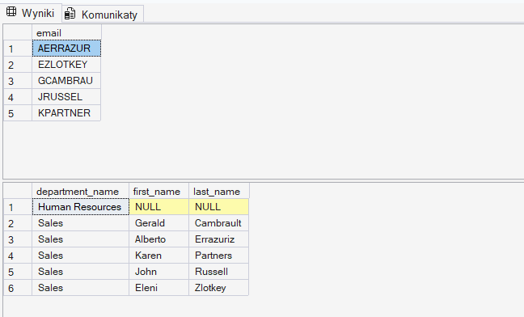

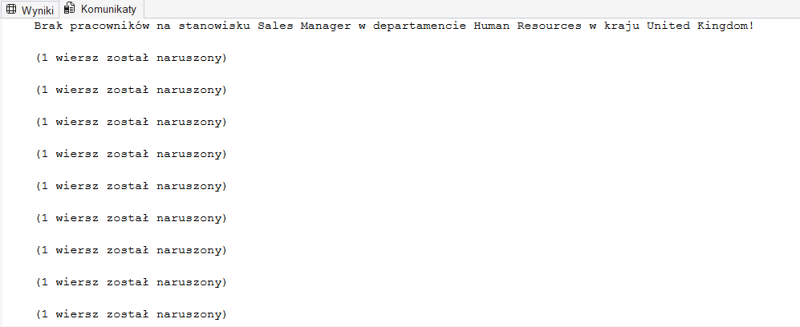

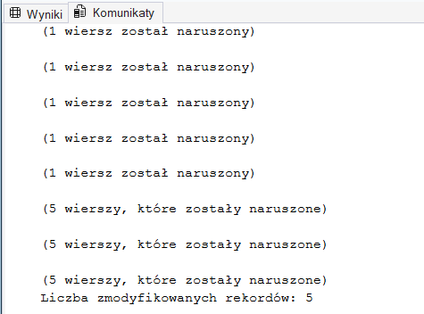

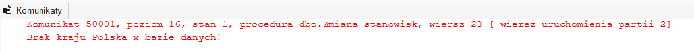

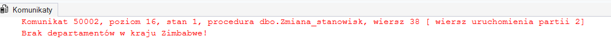


#### Wyniki w PostgreSQL

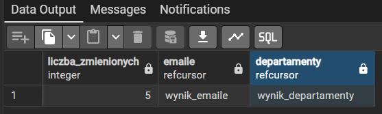

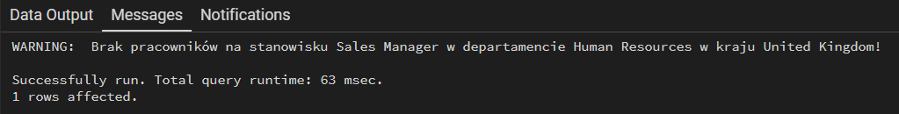

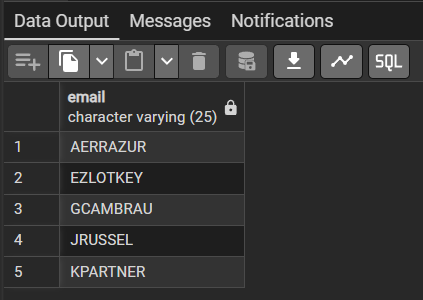

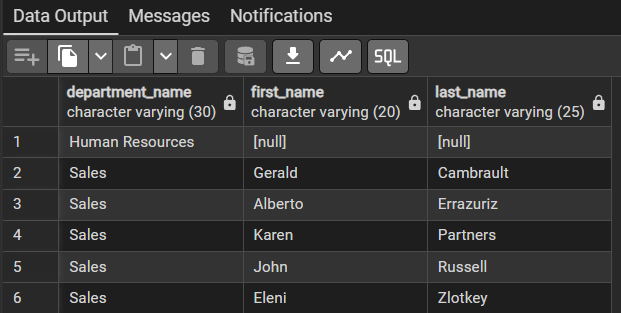

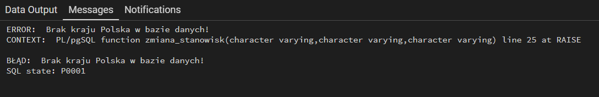

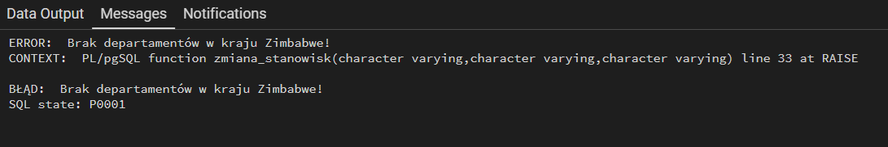
